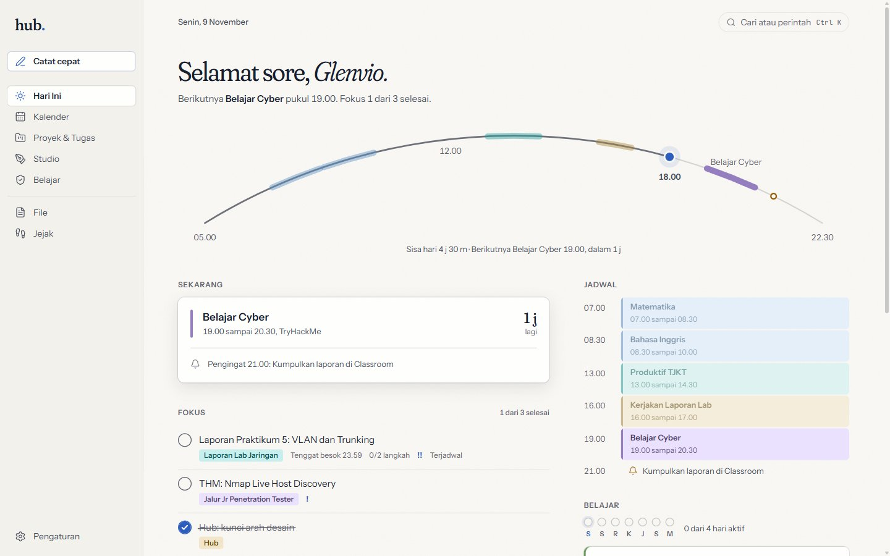
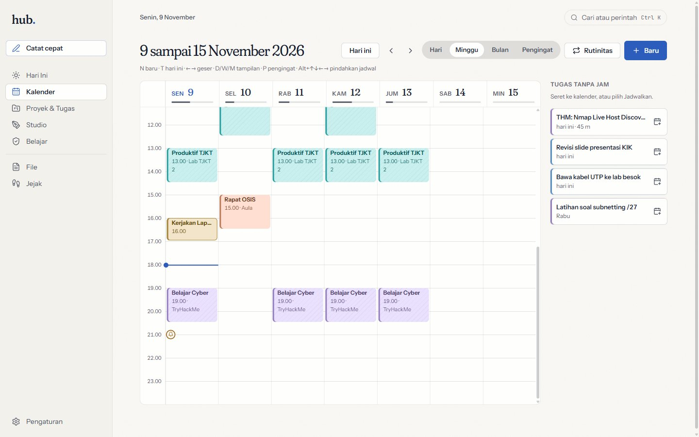
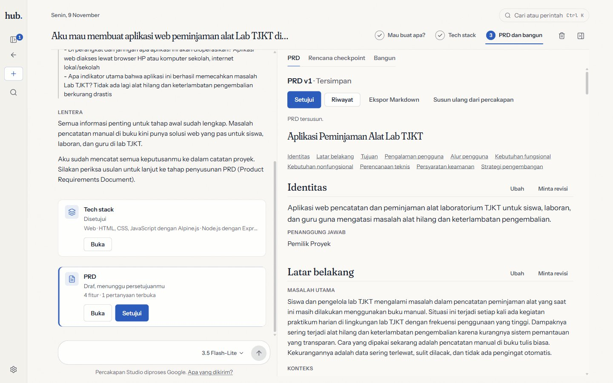

# Hub

Ruang kerja pribadi yang *local-first* untuk Windows: jadwal, rutinitas, pengingat, tugas,
proyek, progres belajar cybersecurity, file, dan jejak semuanya, di satu aplikasi desktop yang
datanya tetap di komputermu. Hub juga punya **Hub Studio**, tempat ide aplikasi dimatangkan
bersama asisten AI menjadi PRD dan rencana kerja, lalu dibangun oleh Claude Code.

*A local-first personal workspace for Windows (schedule, tasks, files, learning progress) with an
AI-assisted project studio. The interface is in Indonesian.*

Hub gratis dan bersumber terbuka dengan [lisensi MIT](LICENSE). Antarmukanya berbahasa Indonesia dan dibuat terutama untuk
pelajar, misalnya siswa SMK yang mengatur tugas sekolah, praktikum, dan belajar mandiri.



| Kalender | Hub Studio |
|---|---|
|  |  |

Tangkapan layar memakai data contoh.

## Fitur

- **Hari Ini:** Busur Hari (hari digambar dari jam bangun sampai tidur), apa yang sedang berjalan,
  dan paling banyak tiga Fokus. Malam hari berganti menjadi **Tutup Hari** untuk meninjau hari.
- **Proyek & Tugas:** Kotak Masuk, tugas dengan tanggal kerja yang terpisah dari tenggat, proyek
  per Ruang (Sekolah, Belajar Cyber, Pribadi, ...) dengan progres yang dihitung dari tugasnya, dan
  tonggak yang mengelompokkan tugas.
- **Kalender:** tampilan hari, minggu, dan bulan, blok waktu untuk tugas, rutinitas (misalnya
  jadwal pelajaran), dan pengingat dengan notifikasi Windows.
- **Catat Cepat:** `Ctrl+Alt+H` dari aplikasi mana pun, satu baris seperti "laporan lab besok
  19.00 #jaringan !!" dibaca menjadi tugas, pengingat, jadwal, atau catatan.
- **Belajar:** jalur belajar (TryHackMe, Hack The Box, CTF, lab sekolah, homelab), materi, timer
  sesi, dan sasaran mingguan yang tidak menghukum hari yang terlewat.
- **File:** seret file dari Explorer; Hub menyimpan rujukan ke file asli dan tetap menemukannya
  saat dipindah. Salinan ke Vault bila diminta, otomatis bila file berasal dari flashdisk.
- **Jejak dan pencarian:** riwayat semua perubahan, dan `Ctrl+K` untuk mencari apa saja.
- **Hub Studio:** tiga tahap bersama Lentera (asisten berbasis Google Gemini): *Mau buat apa?*,
  *Tech stack*, lalu *PRD dan bangun*. Hub memeriksa PRD dan rencana checkpoint, dan Claude Code
  dapat mengerjakannya lewat jembatan MCP `hub-mcp.exe`. Setiap tahap tetap kamu setujui sendiri.
- **Sistem:** SQLite lokal dengan cadangan harian, ekspor semua data ke JSON, mulai bersama
  Windows ke tray, installer per pengguna tanpa hak admin.

## Privasi

- Semua data tersimpan di `%LOCALAPPDATA%\Hub` dan tidak dikirim ke mana pun.
- Pengecualiannya hanya Hub Studio: percakapan dan dokumen Studio dikirim ke Gemini API milik
  Google, dan hanya saat kamu mengirim pesan atau menekan tombol susun. Pada tier gratis Google
  dapat memakai data itu untuk mengembangkan produknya; Hub menyebutkannya di bawah kolom
  percakapan.
- Kunci Gemini disimpan di Windows Credential Manager, bukan di file biasa.
- API lokal (untuk ULTRON dan Claude Code) hanya mendengar di `127.0.0.1`, selalu meminta token,
  dan bisa dimatikan per klien di Pengaturan.

## Spesifikasi

Hub ringan: laptop yang sanggup menjalankan Windows 11 sanggup menjalankan Hub.

| | Minimum | Dianjurkan |
|---|---|---|
| Sistem operasi | Windows 11 64-bit | Windows 11 64-bit versi terbaru |
| Prosesor | 64-bit, 2 core (syarat Windows 11) | 4 core atau lebih |
| RAM | 4 GB (syarat Windows 11) | 8 GB |
| Ruang disk | 100 MB (aplikasi sekitar 22 MB, sisanya data dan cadangan) | 500 MB, bila banyak memakai Vault |
| Lainnya | WebView2 (sudah ada di Windows 11) | Internet hanya untuk Hub Studio |

Yang terukur di laptop pengembang (Core i5-13420H, RAM 24 GB): installer 5,9 MiB, jendela tampil
dalam 0,53 sampai 0,65 detik, memori 116 sampai 128 MB saat jendela terbuka, dan sekitar 3 MB saat
Hub diam di tray. Windows 10 belum diuji.

### Hub + ULTRON

ULTRON, asisten suara yang memakai API lokal Hub, adalah aplikasi terpisah yang belum dibuka untuk
umum. Ia menjalankan model AI di laptop sendiri (model bahasa, pengenal suara, dan suara), jadi jauh
lebih berat daripada Hub:

| | Minimum | Dianjurkan |
|---|---|---|
| Kartu grafis | NVIDIA dengan VRAM 6 GB (misalnya RTX 3050 6 GB, RTX 4050) | NVIDIA dengan VRAM 8 GB atau lebih |
| RAM | 16 GB | 24 GB atau lebih |
| Ruang disk | 15 GB di SSD (model AI dan dependensinya) | 25 GB di SSD |
| Lainnya | Mikrofon, Windows 11 64-bit, Hub | Headset |

ULTRON baru diuji di laptop pengembang (RTX 4050 Laptop 6 GB, RAM 24 GB): model bahasanya memakai
sekitar 3 GB VRAM. Mode tanpa kartu grafis NVIDIA sedang diuji; sampai hasilnya ada, laptop tanpa
NVIDIA cukup memakai Hub saja, karena Hub berjalan penuh tanpa ULTRON.

## Memasang

1. Unduh `Hub_<versi>_x64-setup.exe` dari halaman [Releases](../../releases/latest).
2. Opsional: cocokkan sidik jarinya dengan SHA-256 di catatan rilis.

   ```powershell
   Get-FileHash .\Hub_<versi>_x64-setup.exe -Algorithm SHA256
   ```

3. Jalankan installer. Installer belum ditandatangani, jadi Windows SmartScreen menampilkan
   "Windows protected your PC". Itu peringatan untuk aplikasi yang belum dikenal Windows, bukan
   tanda virus: pilih "More info", pastikan nama berkasnya `Hub_<versi>_x64-setup.exe`, lalu pilih
   "Run anyway". Installer tidak meminta hak admin.
4. Hub terbuka sendiri setelah terpasang. Coba `Ctrl+Alt+H` dari aplikasi mana pun untuk Catat
   Cepat.

Hub dipasang untuk akunmu saja di `%LOCALAPPDATA%\Programs\Hub`, terpisah dari datanya, jadi
memperbarui atau mencopot Hub tidak menyentuh datamu. Jalan pertama mendaftarkan Hub untuk mulai
bersama Windows (diam di tray); matikan di Pengaturan > Sistem & data. Menutup jendela
menyembunyikan Hub ke tray; keluar lewat menu tray "Keluar dari Hub".

Mencopot: Settings > Apps > Hub. Datamu tetap ada di `%LOCALAPPDATA%\Hub`; hapus folder itu
sendiri bila ingin menghapus datanya juga.

### Memakai Hub Studio

1. Buat kunci Gemini API di Google AI Studio (tier gratis cukup untuk mencoba).
2. Tempel kuncinya di Pengaturan > Integrasi AI, lalu tekan "Uji koneksi".
3. Untuk tahap *Bangun*, pasang Claude Code (perlu akun Claude berbayar), lalu tekan
   "Pasang ke Claude Code" di Pengaturan > Integrasi AI. Hub menjelaskan apa yang akan diubah
   sebelum mendaftarkan `hub-mcp.exe` dan skill `/hub-connect`.

### Pintasan

- `Ctrl+Alt+H` dari mana saja: Catat Cepat.
- `Ctrl+K` di Hub: pindah halaman, buat apa saja, dan cari.
- Daftar tugas: panah memilih, Spasi selesai, Enter membuka, Alt+panah mengurutkan, Delete
  menghapus (bisa diurungkan).
- Kalender: N baru, T hari ini, D/W/M tampilan, panah bergeser, Alt+panah memindahkan jadwal.

## Membangun dari kode sumber

Prasyarat (lihat juga [prasyarat Tauri untuk Windows](https://v2.tauri.app/start/prerequisites/)):

- Microsoft C++ Build Tools dengan beban kerja "Desktop development with C++"
- Rust stable dengan toolchain MSVC (minimal 1.90), lewat `rustup`
- Node.js 24 dan npm
- WebView2 (sudah ada di Windows 11)

```powershell
git clone <alamat repositori ini> Hub
cd Hub
npm ci                 # dependensi sesuai package-lock.json
npm run tauri build    # antarmuka, hub.exe, hub-mcp.exe, lalu installer NSIS
```

Installer ada di `target\release\bundle\nsis\Hub_<versi>_x64-setup.exe`. Versi alat yang dipakai
untuk rilis resmi dan sidik jarinya ada di [docs/finalisasi/BUILD.md](docs/finalisasi/BUILD.md).

### Pengembangan

```powershell
npm run tauri dev      # jendela Hub dengan hot reload
npm run dev            # antarmuka saja di browser dengan data demo: http://127.0.0.1:1430
```

Pakai folder data terpisah saat mengembangkan agar datamu sendiri tidak tersentuh:

```powershell
cargo run -p hub-core --bin hub-seed -- $env:TEMP\hub-demo   # isi data contoh
$env:HUB_DATA_DIR = "$env:TEMP\hub-demo"; npm run tauri dev
```

Di mode `npm run dev`, `localStorage["hub:t"] = "21:05"` lalu muat ulang mengunci jam simulasi,
untuk melihat cahaya pagi, siang, senja, dan malam tanpa menunggu.

### Pemeriksaan

Jalankan sebelum mengirim perubahan; semuanya harus lulus.

```powershell
cargo test --workspace
cargo clippy --workspace --all-targets -- -D warnings
npm run typecheck
npm run lint
npm test
npm run check:contrast   # kontras warna untuk semua cahaya dan tinta
```

Tipe TypeScript di `src/data/generated` dibuat dari tipe Rust oleh `npm run test:core`; jalankan
ulang setelah mengubah tipe yang dibagi ke antarmuka.

## Struktur

| Folder | Isi |
|---|---|
| `crates/hub-core` | Inti domain dan satu-satunya kode yang menyentuh SQLite |
| `crates/hub-api` | API lokal di 127.0.0.1 untuk ULTRON dan Claude Code |
| `crates/hub-ai` | Klien Gemini untuk Hub Studio |
| `crates/hub-mcp` | Jembatan MCP stdio antara Claude Code dan Hub |
| `src-tauri` | Aplikasi desktop: jendela, tray, pengingat, perintah untuk antarmuka |
| `src` | Antarmuka React dan TypeScript |
| `design` | Design tokens dan prototipe awal |
| `docs` | Arsitektur, desain, Hub Studio, dan diagram |

Bacaan lanjut: [arsitektur](docs/architecture.md), [desain](docs/design.md),
[Hub Studio](docs/studio.md), [diagram](docs/finalisasi/diagram/),
[catatan rilis](CHANGELOG.md), keputusan desain dan glosarium di [CONTEXT.md](CONTEXT.md), dan
riwayat pengembangan per checkpoint di [docs/checkpoints.md](docs/checkpoints.md).

ULTRON, asisten suara yang memakai API lokal Hub, adalah aplikasi terpisah dan tidak ada di
repositori ini (spesifikasinya di [Hub + ULTRON](#hub--ultron)). Hub berjalan penuh tanpa ULTRON.

## Batasan

- Hanya Windows, dan baru diuji di Windows 11.
- Installer belum ditandatangani.
- Hub Studio memerlukan internet dan kunci Gemini; kuota gratis Gemini kecil (dihitung per
  model), dan isi dokumen buatan AI tetap harus kamu tinjau.
- Satu pengguna per komputer: tidak ada sinkronisasi, akun daring, atau aplikasi ponsel.
- Antarmuka hanya berbahasa Indonesia.

Daftar lengkap: [docs/finalisasi/KNOWN_LIMITATIONS.md](docs/finalisasi/KNOWN_LIMITATIONS.md).

## Berkontribusi

Laporan bug dan usulan lewat Issues, perubahan lewat Pull Request. Bahasa Indonesia atau Inggris
sama-sama boleh. Untuk perubahan besar, buka Issue dulu agar arahnya disepakati, dan pastikan
semua [pemeriksaan](#pemeriksaan) lulus sebelum mengirim Pull Request.

## Lisensi

[MIT](LICENSE). Kamu bebas memakai, mengubah, dan membagikan Hub, termasuk untuk keperluan
komersial, asal pemberitahuan hak cipta dan lisensinya tetap disertakan. Hub diberikan apa adanya,
tanpa jaminan.
